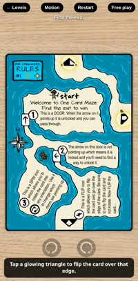
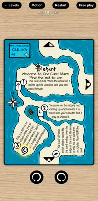
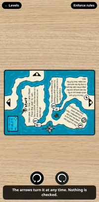
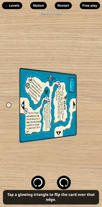
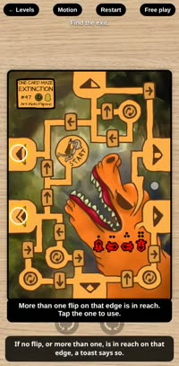
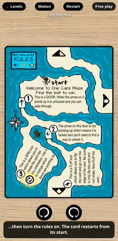
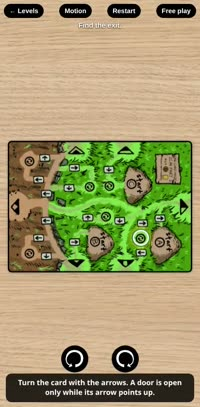
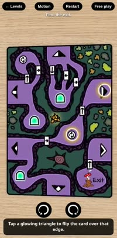
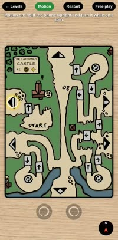

# One Card Maze — level picker

All the One Card Maze cards in one place, with a level picker in front of the original game.

The cards and game code come from [singingsimon's repos](https://github.com/singingsimon?tab=repositories) / [onecardmaze.com](https://onecardmaze.com). All credit goes to the original author.

## Play locally

```
make dev            # or: make dev PORT=9000
```

Open http://localhost:8000, then pick a card. Drag or swipe to flip it; the side buttons rotate it. Inside a level, the top-right button switches between free play and enforced rules; switching to rules restarts the card.

## Demo

Recorded on a phone-sized screen. Click a clip to play it. `make demo` records them again, plus desktop versions in `demo/clips/desktop/`.

| [](demo/clips/phone/tutorial.mp4)<br>**Full tutorial** | [](demo/clips/phone/01-level-picker.mp4)<br>Level picker | [](demo/clips/phone/02-free-play.mp4)<br>Free play |
|:-:|:-:|:-:|
| [](demo/clips/phone/03-rules-spin-and-flip.mp4)<br>Spin and flip with rules | [](demo/clips/phone/04-swipe-to-flip.mp4)<br>Swipe to flip | [](demo/clips/phone/05-switch-modes.mp4)<br>Switch modes |
| [](demo/clips/phone/06-pick-a-start.mp4)<br>Pick a start | [](demo/clips/phone/07-portals.mp4)<br>Portals | [](demo/clips/phone/08-motion-control.mp4)<br>Motion control |
